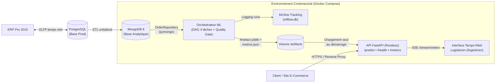
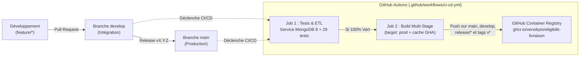

# Éligibilité à la Livraison Express – Industrialisation MLOps

Application Python industrialisée (Clean Code & MLOps) permettant de prédire l'éligibilité des commandes à la livraison express. Elle assure l'ingestion de commandes depuis une base de données de production (**MongoDB** ou **PostgreSQL** via le pattern *Repository*, avec repli sur générateur synthétique), la validation et le nettoyage des données, l'entraînement orchestré d'un pipeline `scikit-learn` tracé dans **MLflow**, le monitoring API + ML, un flux temps-réel pour les logisticiens, et l'exposition d'une **API REST FastAPI** conteneurisée via **Docker** et publiée sur **GitHub Container Registry (`ghcr.io`)**.

---

## Architecture Globale du Système



---

## Versions & Stack Technique

| Composant | Technologie / Version |
| :--- | :--- |
| Langage | Python `3.12` (compatible `>=3.10`) |
| Machine Learning & Tracking | `scikit-learn`, `pandas`, `numpy`, `joblib`, `mlflow` |
| API & Temps-Réel | `FastAPI`, `Uvicorn`, `Pydantic v2`, Server-Sent Events (SSE) |
| Base de données | `MongoDB 8` (`pymongo>=4.10.0`) / `PostgreSQL` (`psycopg`) |
| Conteneurisation & CI/CD | `Docker` (Build Multi-Stage 3 couches), `Docker Compose`, `GitHub Actions`, `GHCR` |

---

## Structure du Projet

```text
Projet/
├── .github/workflows/
│   └── ci-cd.yml                  Pipeline CI/CD (Tests + Build & Push GHCR)
├── artifacts/                     Modèle sérialisé (joblib), métriques et Model Card
├── data/generated/                Snapshots CSV des données nettoyées d'entraînement
├── reports/                       Graphiques d'audit, matrice de confusion, importance des variables
├── src/eligibilite_livraison/
│   ├── config.py                  Chemins, hyperparamètres et constantes du modèle
│   ├── data.py                    Génération, validation, nettoyage et normalisation ERP
│   ├── model.py                   Pipeline scikit-learn (ColumnTransformer + LogisticRegression)
│   ├── predict.py                 Prédictions unitaires et batch avec seuil configurable
│   ├── training.py                Entraînement, évaluation, suivi MLflow et sauvegarde d'artefacts
│   ├── train.py                   Point d'entrée CLI d'entraînement direct
│   ├── orchestrator.py            Orchestrateur MLOps (DAG de tâches, retries, Quality Gate, scheduler)
│   ├── api.py                     Microservice FastAPI (/health, /metrics, /predict, /logisticien, /stream/orders)
│   └── infrastructure/
│       ├── contract/
│       │   └── order_repository.py        Contrat générique OrderRepository (Protocol)
│       └── implementation/
│           ├── mongo_order_repository.py  Adaptateur MongoDB (Base analytique de production)
│           └── postgres_order_repository.py Adaptateur PostgreSQL (Base OLTP historique)
├── tests/                         Suite de tests unitaires et d'intégration (API, Data, Repo, Orchestrateur)
├── CHANGELOG.md                   Journal des versions (Keep a Changelog / SemVer)
├── CONTRIBUTING.md                Guide de contribution et workflow GitFlow
├── CODE_OF_CONDUCT.md             Code de conduite
├── SECURITY.md                    Politique de sécurité
├── Dockerfile                     Image Docker multi-stage 3 couches (builder / prod / test) rootless
├── docker-compose.yml             Environnement de développement (dev)
├── docker-compose.test.yml        Environnement de test isolé avec MongoDB 8 (test)
└── docker-compose.prod.yml        Environnement de production (MongoDB + API + Orchestrateur)
```

---

## Installation Locale

Depuis le dossier `Projet` :

```powershell
python -m venv .venv
.\.venv\Scripts\Activate.ps1
python -m pip install --upgrade pip
python -m pip install -r requirements.txt
python -m pip install -e .
```

---

## Utilisation

### 1. Traitement Batch & Orchestrateur MLOps

L'orchestrateur découpe l'entraînement par lot en 4 tâches atomiques (`extract_orders_task` avec retries, `validate_and_clean_task`, `train_and_evaluate_task` avec **Model Quality Gate**, et `publish_artifacts_task` vers MLflow) :

```powershell
# Exécution unique du flow orchestré (utilise MongoDB si disponible, sinon données synthétiques)
python -m eligibilite_livraison.orchestrator

# Mode démon planifié (ex. ré-entraînement toutes les 24h sur MongoDB)
python -m eligibilite_livraison.orchestrator --schedule --interval-seconds 86400
```

### 2. API de Service, Monitoring & Temps-Réel (FastAPI)

Au démarrage, l'API **charge uniquement l'artefact ML pré-entraîné** (`artifacts/express_delivery_model.joblib`) sans jamais ré-entraîner le modèle.

```powershell
uvicorn eligibilite_livraison.api:app --host 0.0.0.0 --port 8000 --reload
```

Endpoints exposés :
- `GET /docs` : Contrat **OpenAPI / Swagger UI** interactif
- `GET /health` : Sonde de santé (API, modèle chargé en mémoire, ping MongoDB, uptime)
- `GET /metrics` : Monitoring complet (latence moyenne, volume de requêtes/erreurs, métriques d'entraînement ML et taux de prédictions express en direct pour détecter la dérive)
- `POST /predict` : Prédiction unitaire
- `POST /predict/batch` : Prédiction par lot avec seuil configurable
- `GET /logisticien` : **Interface web temps-réel** à destination du logisticien (notifications en direct via **Server-Sent Events** `/stream/orders` lorsqu'une commande arrive sur `POST /stream/order`)
- `POST /train` : Ré-entraînement explicite à la demande

### 3. Suivi des expériences (MLflow)

```powershell
mlflow ui --backend-store-uri sqlite:///mlflow.db
```

---

## Conteneurisation Docker & Séparation des Environnements (`dev` / `test` / `prod`)

Le [Dockerfile](Dockerfile) suit un build **multi-stage en 3 couches** (`builder` $\rightarrow$ `prod` $\rightarrow$ `test`) :
- L'image de production (`target: prod`, ~233 Mo compressée) repose sur `python:3.12-slim`, s'exécute en **rootless** (`USER appuser`), n'expose que le port `8000`, embarque un `HEALTHCHECK` et **exclut totalement `tests/`, `requirements.txt`, `gcc/g++`, `.env` et la documentation**.
- Les variables sensibles sont injectées exclusivement au runtime via variables d'environnement (`MONGO_URI`, `MONGO_DB`).

```powershell
# Environnement de Test (target: test + MongoDB 8 isolé)
docker compose -f docker-compose.test.yml up --build --abort-on-container-exit

# Environnement de Production (target: prod + MongoDB + API + Orchestrateur)
docker compose -f docker-compose.prod.yml up -d --build
```

---

## Pipeline CI/CD (GitFlow $\rightarrow$ GitHub Actions $\rightarrow$ GHCR)



Lancer tous les tests localement :

```powershell
python -m unittest discover -s tests -v
```

---

## Estimation Budgétaire (FinOps)

| Poste | Scénario Actuel (On-Premise / Docker Local + GitHub Public) | Scénario Cloud Managé (AWS / GCP + MongoDB Atlas) |
| :--- | :---: | :---: |
| **Compute API (0,5 vCPU / 1 Go RAM, 24/7)** | Inclus serveur interne (~20 €/mois amorti) | ~18 – 25 €/mois *(Cloud Run / ECS Fargate)* |
| **Orchestrateur Batch (1 exécution / jour)** | Inclus serveur interne (0 €) | ~1 – 3 €/mois *(Cloud Run Jobs / Lambda)* |
| **Base de données Analytique (MongoDB)** | Inclus infrastructure ERP (~15 €/mois amorti) | ~55 €/mois *(MongoDB Atlas M10)* |
| **Stockage Artefacts & Logs / Monitoring** | Disque local / volume Docker (0 €) | ~5 €/mois *(S3 / GCS + CloudWatch / Prometheus)* |
| **CI/CD & Registre Docker (GHCR)** | **0 €/mois** *(GitHub Actions Public + GHCR)* | **0 €/mois** *(GitHub Actions Public + GHCR)* |
| **TOTAL ESTIMÉ** | **~35 €/mois** *(infra interne)* | **~80 – 90 €/mois** |

---

## Conformité & Normes (RGPD & AI Act)

1. **Minimisation des données (Art. 5 RGPD)** : aucune donnée nominative / PII (`nom`, `prénom`, `email`, `téléphone`, `adresse postale exacte`) n'est collectée ni traitée par le modèle ML. Les commandes utilisent uniquement un identifiant technique pseudonymisé (`order_id`) et des attributs logistiques agrégés (`distance_km`, `delivery_zone`, `customer_type`).
2. **Séparation des environnements & anonymisation** : les environnements `dev` et `test` utilisent exclusivement des jeux de données synthétiques générés localement, sans accès à la base de production.
3. **Transparence & Explicabilité (Art. 22 RGPD / AI Act)** : utilisation d'un modèle linéaire explicable (`LogisticRegression`) accompagné d'une *Model Card* (`artifacts/model_card.json`) et d'une exportation des coefficients d'importance (`reports/feature_importance.csv`). La prédiction sert d'aide à la décision validée par les règles métier.
4. **Sécurité dès la conception (*Security by Design*, Art. 32 RGPD)** : conteneur Docker *rootless*, absence de secrets/fichiers `.env` dans Git et Docker, isolation de la base analytique MongoDB vis-à-vis de la base OLTP critique.
